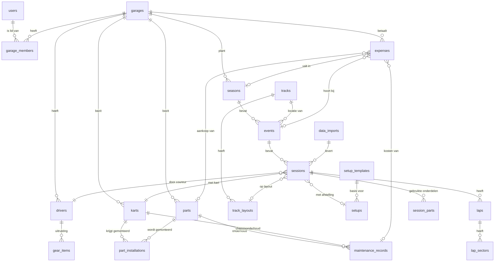

# CorsaIQ — Datamodel (v0.1, concept)

Dit document beschrijft het datamodel van CorsaIQ: een tool waarmee kartcoureurs (van hobby tot topniveau) hun seizoen, kart, onderdelen, afstellingen, kosten en rondetijden bijhouden.

Uitgangspunten:

- **Relationele database (PostgreSQL).** De data is sterk gekoppeld (sessie ↔ afstelling ↔ onderdelen ↔ rondetijden); dat past bij SQL. Werkt met o.a. Supabase, Neon of Vercel Postgres.
- **Tabel- en kolomnamen in het Engels**, `snake_case`. De UI is vertaald (nl/en/de/fr), de data niet.
- **Eén eigenaar per gegeven: de `garage`.** Een hobbycoureur heeft één garage met alleen zichzelf erin; een team heeft één garage met meerdere leden en coureurs. Zo hoeven we later niets om te bouwen voor teams.
- **Opslag in SI-eenheden, tonen in de voorkeur van de gebruiker.** Tijden in milliseconden, druk in bar, temperatuur in °C, lengte in mm, bedragen in centen + valutacode.
- **Ruwe telemetrie niet in de database.** Loggerbestanden gaan naar bestandsopslag; de database bewaart sessies, ronden, sectoren en samenvattingen.
- **Afstellingen zijn snapshots.** Een sessie verwijst naar een vastgelegde afstelling die nooit meer verandert, zodat je achteraf altijd ziet waarmee je reed.

---

## Overzicht



---

## 1. Accounts en eigendom

### `users`
Het login-account (beheerd door de auth-provider).

| kolom | type | toelichting |
|---|---|---|
| id | uuid PK | |
| email | text | |
| display_name | text | |
| locale | text | `nl`, `en`, `de`, `fr` |
| unit_system | text | `metric` / `imperial` (weergave) |
| currency | char(3) | standaardvaluta, bijv. `EUR` |
| created_at | timestamptz | |

### `garages`
De werkruimte die alle data bezit. Eén per hobbycoureur, één per team.

| kolom | type | toelichting |
|---|---|---|
| id | uuid PK | |
| name | text | bijv. "Ron Racing" |
| plan | text | `free`, `hobby`, `pro`, `team` |
| currency | char(3) | valuta van het budget |
| created_at | timestamptz | |

### `garage_members`
Wie toegang heeft tot een garage.

| kolom | type | toelichting |
|---|---|---|
| garage_id | uuid FK | |
| user_id | uuid FK | |
| role | text | `owner`, `mechanic`, `driver`, `viewer` |
| PK | (garage_id, user_id) | |

### `drivers`
De coureur zelf. Los van `users`, want een coureur (bijv. een kind) hoeft geen eigen account te hebben, en een monteur heeft een account maar is geen coureur.

| kolom | type | toelichting |
|---|---|---|
| id | uuid PK | |
| garage_id | uuid FK | |
| user_id | uuid FK, nullable | als de coureur zelf inlogt |
| name | text | |
| race_number | text | |
| weight_kg | numeric | voor ballast/gewicht-berekening |
| licence_number | text | |

---

## 2. Kart en onderdelen

### `karts`
Een kart = een chassis met een identiteit. Wat erop zit, staat in `part_installations`.

| kolom | type | toelichting |
|---|---|---|
| id | uuid PK | |
| garage_id | uuid FK | |
| name | text | bijv. "Kart A" |
| chassis_brand | text | Tony Kart, CRG, Kart Republic, … |
| chassis_model | text | |
| chassis_year | int | |
| homologation | text | |
| serial_number | text | |
| class | text | bijv. `X30 Senior`, `OK`, `Rotax Max`, `KZ2` |
| status | text | `active`, `spare`, `sold`, `retired` |
| usage_limit_minutes | int, nullable | groot onderhoud van het chassis na zoveel minuten |
| component_limits | jsonb | grens per chassiscomponent in minuten, bijv. `{ "axle_bearings": 600 }` |
| notes | text | |

### `parts`
Alles wat je bezit en wilt volgen: motor, banden, assen, tandwielen, carburateur, stoel, etc.

| kolom | type | toelichting |
|---|---|---|
| id | uuid PK | |
| garage_id | uuid FK | |
| category | text | zie lijst hieronder |
| brand | text | |
| model | text | |
| serial_number | text | motornummer, bandencode |
| spec | jsonb | categoriespecifiek, bijv. `{ "teeth": 82 }`, `{ "compound": "MG Red", "size_front": "10x4.60-5" }`, `{ "hardness": "medium" }` |
| status | text | `in_stock`, `installed`, `worn`, `sold`, `discarded` |
| purchased_on | date | |
| purchase_price_cents | int | ook als `expense` vastgelegd |
| usage_limit_minutes | int, nullable | bijv. revisie na 600 min |
| component_limits | jsonb | grens per motorcomponent in minuten, bijv. `{ "piston": 360 }` |
| notes | text | |

Categorieën (`category`): `engine`, `carburettor`, `exhaust`, `tyre_set`, `rim_set`, `rear_axle`, `sprocket`, `chain`, `seat`, `brake_disc`, `brake_pads`, `steering_wheel`, `front_hubs`, `spindle`, `bumper_bodywork`, `data_logger`, `other`.

Draaiuren en bandenverbruik worden **niet opgeslagen maar berekend** uit de sessies waarin het onderdeel gebruikt is (zie `session_parts`). Zo kloppen ze altijd.

### `part_installations`
Geschiedenis van welk onderdeel wanneer op welke kart zat.

| kolom | type | toelichting |
|---|---|---|
| id | uuid PK | |
| part_id | uuid FK | |
| kart_id | uuid FK | |
| installed_at | timestamptz | |
| removed_at | timestamptz, nullable | `null` = zit er nu op |

Regel: één onderdeel kan op één moment maar op één kart zitten.

> **Coureurs:** `drivers` heeft `first_name` (verplicht) en `last_name`; `name` is een door de database berekende kolom (voornaam + achternaam) voor weergave.

### `maintenance_records`
Revisies, onderhoud en reparaties.

| kolom | type | toelichting |
|---|---|---|
| id | uuid PK | |
| part_id | uuid FK, nullable | bijv. motorrevisie |
| kart_id | uuid FK, nullable | bijv. chassis rechtgezet |
| performed_on | date | |
| type | text | `revision`, `service`, `repair`, `inspection` |
| performed_by | text | eigen beheer of motorbouwer |
| description | text | |
| resets_usage | boolean | teller "sinds laatste revisie" weer op 0 |
| components | text[] | behandelde componenten. Motor: `piston`, `big_end`, `crankshaft`, `main_bearings`, `cylinder`, `reed_valve`, `clutch`, `gaskets`. Chassis: `frame`, `axle_bearings`, `wheel_bearings`, `steering`, `brakes`, `fasteners` |

De **totale draaitijd** van een onderdeel loopt altijd door. Daarnaast zijn er twee soorten tellers: *sinds laatste revisie* (de laatste beurt met `resets_usage`) en *per component* (de laatste beurt waarin dat component voorkomt). Een nieuwe zuiger zet dus alleen de zuigerteller op nul.

Voor een kart werkt het net zo, gemeten over de sessies waarin die kart reed: totaal, *sinds groot onderhoud* en per chassiscomponent. Elke teller kan een eigen grens hebben (`usage_limit_minutes`, `component_limits`); vanaf 90% staat hij onder “Onderhoud nodig” op het overzicht.

---

### `gear_items`
Uitrusting van een coureur: helm, overall, handschoenen, schoenen, bodyprotector, nekbescherming, regenpak. Helm en overall hebben een homologatie die verloopt; vanaf 60 dagen voor `valid_until` (en daarna) verschijnt het item op het overzicht onder "Homologatie verloopt" (`lib/gear.ts`).

| kolom | type | toelichting |
|---|---|---|
| id | uuid PK | |
| garage_id | uuid FK | |
| driver_id | uuid FK, nullable | van wie; leeg = gedeeld. RLS eist een coureur uit dezelfde garage |
| category | text | `helmet`, `suit`, `gloves`, `boots`, `rib_protector`, `neck_brace`, `rain_suit`, `other` |
| brand, model, size | text, nullable | |
| homologation | text, nullable | bijv. "Snell K2020", "CIK-FIA Level 2" |
| valid_until | date, nullable | laatste dag dat de homologatie geldt |
| status | text | `in_use`, `spare`, `retired` (afgedankt telt niet mee voor waarschuwingen) |
| purchased_on | date, nullable | |
| purchase_price_cents | int, nullable | ook geboekt als uitgave (categorie `gear`), net als bij onderdelen |
| notes | text, nullable | |

## 3. Seizoen, circuits en evenementen

### `seasons`

| kolom | type | toelichting |
|---|---|---|
| id | uuid PK | |
| garage_id | uuid FK | |
| driver_id | uuid FK, nullable | seizoen van één coureur in een team |
| name | text | bijv. "2027 – NK Rotax Senior" |
| year | int | |
| class | text | |
| championship | text | |
| budget_cents | int, nullable | |

### `tracks`
Gedeelde catalogus van circuits (niet per garage), aan te vullen door gebruikers.

| kolom | type | toelichting |
|---|---|---|
| id | uuid PK | |
| name | text | bijv. "Circuit Genk" |
| country | char(2) | |
| latitude / longitude | numeric | voor weerdata en GPS-matching |
| created_by_garage_id | uuid, nullable | `null` = officiële catalogus |

### `track_layouts`
Een circuit kan meerdere configuraties hebben.

| kolom | type | toelichting |
|---|---|---|
| id | uuid PK | |
| track_id | uuid FK | |
| name | text | bijv. "Full layout", "Short" |
| length_m | int | |
| sector_count | int | |

### `events`
Een racedag of trainingsdag.

| kolom | type | toelichting |
|---|---|---|
| id | uuid PK | |
| garage_id | uuid FK | |
| season_id | uuid FK, nullable | training buiten seizoen mag |
| track_id | uuid FK | |
| name | text | |
| type | text | `training`, `race`, `test` |
| starts_on / ends_on | date | |
| result_position | int, nullable | eindklassering |
| notes | text | |

---

## 4. Sessies, afstellingen en rondetijden

### `sessions`
Eén keer de baan op: het hart van het model.

| kolom | type | toelichting |
|---|---|---|
| id | uuid PK | |
| event_id | uuid FK | |
| kart_id | uuid FK | |
| driver_id | uuid FK | |
| setup_id | uuid FK, nullable | vastgelegde afstelling |
| track_layout_id | uuid FK, nullable | |
| data_import_id | uuid FK, nullable | bron van de ronden |
| type | text | `practice`, `qualifying`, `heat`, `prefinal`, `final`, `test` |
| started_at | timestamptz | |
| duration_s | int | voor draaiuren |
| best_lap_ms | int, nullable | afgeleid, voor snel overzicht |
| conditions | jsonb | `{ "weather": "dry", "air_temp_c": 18, "track_temp_c": 24, "humidity": 60, "track_state": "rubbered" }` |
| driver_feedback | text | "onderstuur in bocht 3" |
| feedback_tags | jsonb | labels die Claude uit de feedback haalt: `{ handling: ["understeer"], corners: ["3"], phases: ["entry"], topics: ["tyres"], mood: "negative" }`; null zonder feedback |
| position | int, nullable | resultaat van heat/finale |

### `session_parts`
Welke specifieke onderdelen tijdens deze sessie gebruikt zijn. Wordt bij aanmaken automatisch gevuld vanuit `part_installations`, maar kan worden aangepast (bijv. bandenwissel op de grid).

| kolom | type | toelichting |
|---|---|---|
| session_id | uuid FK | |
| part_id | uuid FK | |
| PK | (session_id, part_id) | |

Hiermee bereken je: draaiminuten per motor, aantal heat cycles en ronden per bandenset, en "beste ronde ooit met motor X".

### `setup_templates`
Herbruikbare startafstelling, bijv. "Genk droog".

| kolom | type | toelichting |
|---|---|---|
| id | uuid PK | |
| garage_id | uuid FK | |
| kart_id | uuid FK, nullable | |
| track_id | uuid FK, nullable | |
| name | text | |
| values | jsonb | zelfde structuur als `setups.values` |

### `setups`
Een vastgelegde afstelling, **niet meer aan te passen** na koppeling aan een sessie. Wijzigen = nieuwe `setup` maken (eventueel met `parent_setup_id` om de wijziging te volgen).

| kolom | type | toelichting |
|---|---|---|
| id | uuid PK | |
| garage_id | uuid FK | |
| template_id | uuid FK, nullable | |
| parent_setup_id | uuid FK, nullable | vorige afstelling, voor "wat is er veranderd" |
| values | jsonb | zie hieronder |
| created_at | timestamptz | |

Waarom `jsonb`: welke instellingen bestaan verschilt per klasse en chassis. De velden staan op één plek in `src/lib/setup.ts` (`SETUP_FIELDS`: pad, label, eenheid en soort waarde); het sessieformulier, het opslaan, de samenvattingen en de vergelijkingen lezen die lijst. Een veld toevoegen kan zonder migratie; oudere setups missen het dan gewoon. Bandenspanning staat per wiel (fl, fr, rl, rr = linksvoor, rechtsvoor, linksachter, rechtsachter); oudere setups met één waarde per as (`front`, `rear`) gelden voor beide wielen van die as (`legacyPath`).

```json
{
  "tyre_pressure_cold_bar": { "fl": 0.62, "fr": 0.62, "rl": 0.60, "rr": 0.60 },
  "tyre_pressure_hot_bar":  { "fl": 0.84, "fr": 0.85, "rl": 0.81, "rr": 0.82 },
  "gearing": { "front_teeth": 12, "rear_teeth": 82 },
  "rear_axle": { "hardness": "medium" },
  "rear_track_width_mm": 1395,
  "front_track_width_mm": 1270,
  "ride_height": { "front": "midden", "rear": "laag" },
  "front_end": { "caster": "neutraal", "camber": "-1" },
  "hubs": { "front_length_mm": 95, "rear_length_mm": 110 },
  "carburettor": { "main_jet": 125, "needle": "K98 · 2", "low_screw_turns": 1.25, "high_screw_turns": 1.5 },
  "engine": { "spark_plug": "B10EG" },
  "notes": ""
}
```

Setup-analyse: het circuitscherm zet alle sessies met een rondetijd onder elkaar met hun setup (snelste eerst, afwijkingen van de snelste vet, filter op weer en kart). De sessiepagina toont wat er veranderde ten opzichte van een andere sessie: standaard de vorige sessie van dezelfde kart, of een sessie op hetzelfde circuit.

### `laps`

| kolom | type | toelichting |
|---|---|---|
| id | bigserial PK | veel rijen, dus geen uuid |
| session_id | uuid FK | |
| lap_number | int | |
| lap_time_ms | int | |
| is_valid | boolean | in- en outlap, gemarkeerde ronden |
| is_pit_lap | boolean | |
| max_speed_kmh | numeric, nullable | |
| min_speed_kmh | numeric, nullable | |
| max_rpm | int, nullable | |
| max_water_temp_c | numeric, nullable | |
| max_egt_c | numeric, nullable | uitlaatgastemperatuur |

### `lap_sectors`

| kolom | type | toelichting |
|---|---|---|
| lap_id | bigint FK | |
| sector_number | int | |
| sector_time_ms | int | |
| PK | (lap_id, sector_number) | |

---

## 5. Data-import (dataloggers en CSV)

### `data_imports`
Elke upload of synchronisatie, met het originele bestand in opslag.

| kolom | type | toelichting |
|---|---|---|
| id | uuid PK | |
| garage_id | uuid FK | |
| uploaded_by | uuid FK → users | |
| source | text | `aim`, `alfano`, `unipro`, `mychron_cloud`, `csv`, `manual` |
| file_path | text | pad in bestandsopslag (origineel bewaard) |
| file_format | text | bijv. `xrk`, `drk`, `csv` |
| status | text | `pending`, `parsed`, `failed`, `needs_mapping` |
| error | text, nullable | |
| channel_summary | jsonb | welke kanalen er in zitten (RPM, snelheid, GPS, temp, …) |
| telemetry_path | text, nullable | omgezet naar een vast formaat (bijv. Parquet) voor grafieken |
| created_at | timestamptz | |

Werking:

1. Bestand wordt geüpload, origineel opgeslagen.
2. Een **adapter per bron** zet het om naar één eigen formaat: sessie(s), ronden, sectoren, en een telemetriebestand.
3. Bij CSV vraagt de app éénmalig welke kolom wat is (`needs_mapping`) en onthoudt die mapping.
4. Gebruiker koppelt de sessie aan event, kart, coureur en afstelling (de app doet een voorstel op datum, GPS en de laatst gebruikte kart).

Gedetailleerde telemetrie (samples van 10–100 Hz) blijft buiten de database; dat zijn per sessie honderdduizenden punten.

---

## 6. Kosten

### `expenses`

| kolom | type | toelichting |
|---|---|---|
| id | uuid PK | |
| garage_id | uuid FK | |
| season_id | uuid FK, nullable | |
| event_id | uuid FK, nullable | |
| part_id | uuid FK, nullable | aankoop van een onderdeel |
| maintenance_record_id | uuid FK, nullable | kosten van een revisie |
| gear_item_id | uuid FK, nullable | aankoop van uitrusting |
| spent_on | date | |
| category | text | `entry_fee`, `tyres`, `fuel_oil`, `parts`, `engine_revision`, `track_rental`, `travel`, `accommodation`, `licence`, `gear` (kleding/helm), `other` |
| amount_cents | int | |
| currency | char(3) | |
| description | text | |
| receipt_path | text, nullable | foto van de bon |

Hiermee kun je zien: uitgaven per seizoen tegenover het budget, kosten per evenement, kosten per rijminuut, wat een motor in totaal heeft gekost.

---

## Voorbeeldvragen die het model moet kunnen beantwoorden

- Wat was mijn snelste ronde in Genk, met welke afstelling, welke banden en welke motor?
- Hoeveel minuten heeft motor #1234 gedraaid sinds de laatste revisie?
- Hoeveel ronden en heat cycles zitten er op bandenset C?
- Wat heb ik dit seizoen uitgegeven ten opzichte van mijn budget, per categorie?
- Wat veranderde er in de afstelling tussen heat 2 en de finale, en wat deed dat met de rondetijd?
- Welke onderdelen zitten nu op Kart A?

## Beveiliging

- Elke tabel met `garage_id` krijgt toegangsregels (bijv. Postgres Row Level Security): je ziet alleen data van garages waar je lid van bent.
- Tabellen zonder eigen `garage_id` (`laps`, `lap_sectors`, `session_parts`) erven de toegang via `sessions`.
- `tracks` zijn leesbaar voor iedereen; aanpassen alleen door de maker of beheerder.

## Open keuzes

1. ~~Database/auth-provider~~ **Gekozen: Supabase** (Postgres + auth + opslag + RLS). `users` is daarmee een `profiles`-tabel naast `auth.users`; bestanden (loggerbestanden, bonnen) gaan naar Supabase Storage. Schema: [`supabase/migrations`](../supabase/migrations).
2. **ORM:** Drizzle (dicht bij SQL, lichte TypeScript-types) of Prisma.
3. **Welke loggers eerst:** voorstel AiM (MyChron 5/6) en Alfano 6/7 als eerste, plus CSV. Hier zijn echte voorbeeldbestanden voor nodig.
4. **Teams in v1 of later:** het model ondersteunt het al via `garages`; de vraag is alleen of de UI ervoor in de eerste versie zit.
